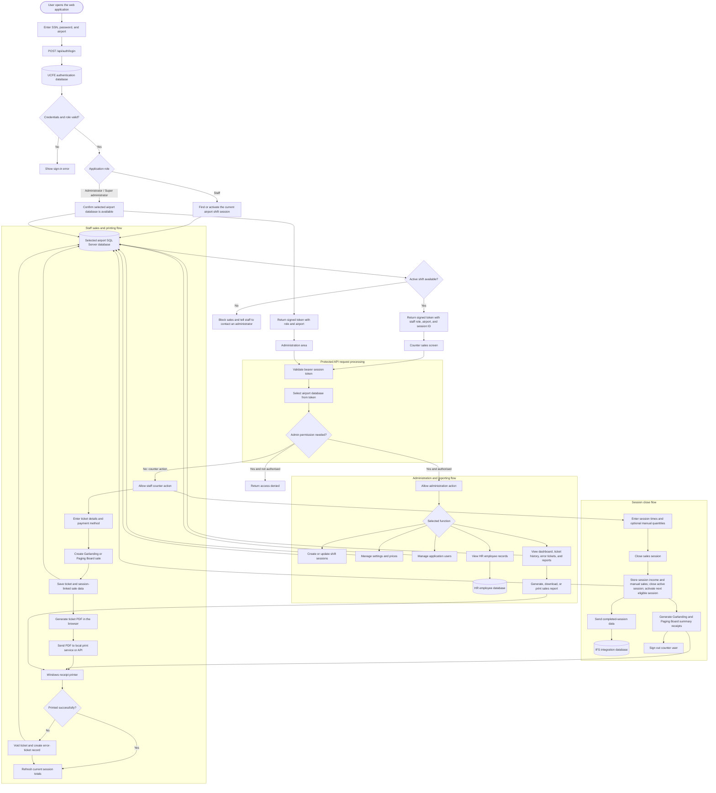
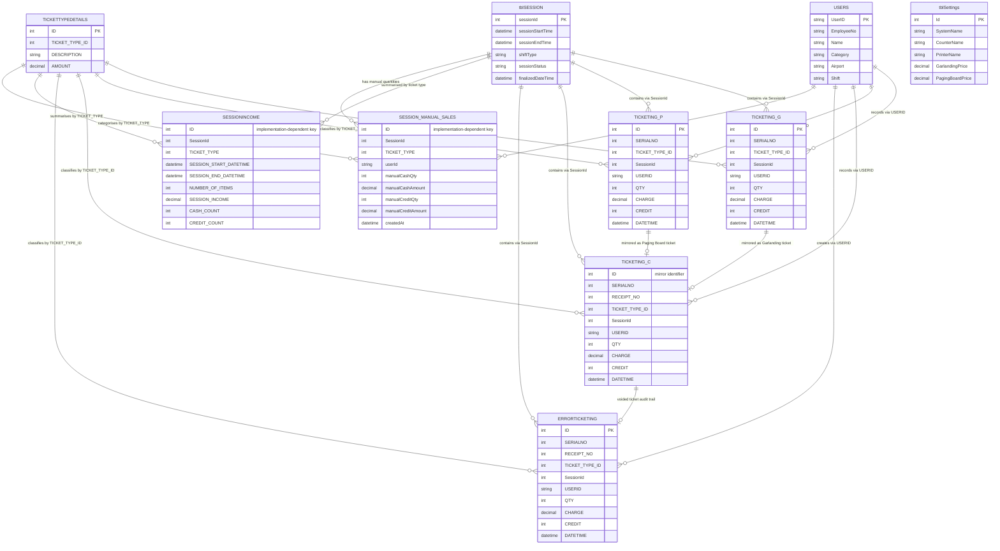

# Airport Arrival Services Counter System

> **System identification:** a multi-airport point-of-sale and session-management system for airport-arrival services. Its supported services are **Garlanding** and **Paging Board** tickets; it is not limited to taxi sales.

The system enables counter staff to sell services, collect cash or card payments, print receipts, and close their shift session. Administrators manage users, shift sessions, prices, operational exceptions, and reports across supported airports.

## Purpose and scope

This repository contains the web application, API, and SQL maintenance scripts used to operate arrival-service counters at **BIA**, **CIAR**, **JIA**, **MRIA**, and **BTIA**. It supports the operational workflow from authenticated staff login through ticket issue, printing, session close, and reporting.

It integrates with the existing UCFE authentication source, airport SQL Server databases, a read-only HR employee source, an optional IFS destination, and Windows receipt printers. Those external databases and printers are deployment dependencies; they are not provisioned by this repository.

## Primary actors

| Actor | Responsibilities |
| --- | --- |
| Counter staff | Sign in to an active shift, record a ticket sale, print a receipt, void a failed-print ticket, view daily totals, and close a sales session. |
| Administrator | View the operational dashboard, manage users and shifts, configure prices, review history and error tickets, access HR records, and generate reports. |
| Super administrator | View sales reports across the permitted administration area. |
| UCFE authentication service | Verifies user credentials and returns the application role. |
| Airport SQL Server databases | Store ticket, session, user, settings, and report data for each airport. |
| IFS integration database | Receives completed session information when available. |
| Receipt printer | Provides available-printer status and prints tickets and session/report receipts. |

## System flow diagram

This flow chart shows the implemented runtime flow. The browser client never connects directly to an airport database: protected requests pass through token, role, and airport-scoping middleware in the API.



### Flow rules reflected in the diagram

- The selected airport is embedded in the signed session and is used to scope all protected sales and administration requests to one airport database.
- Staff can issue sales only after login has located or activated a valid current shift session.
- The ticket is saved before printing. On print failure, the client attempts to void the saved ticket and the API records the exception for administrator review.
- Closing the active session records system and optional manual quantities, updates the session lifecycle, prints two summary receipts, and then ends the counter session. IFS synchronization is attempted during this operation.
- Administrator-only operations are protected by the role middleware; super administrators are routed to sales reporting in the client.

## Entity-relationship diagram

The operational database is maintained separately for each airport. The diagram below documents the logical data model used by the application. It is intentionally labelled as **logical**: much of the existing airport schema is legacy and uses matching `SessionId`, `USERID`, ticket type, serial, and receipt columns rather than database-enforced foreign-key constraints.



### Data-model rules

- `TICKETING_G` and `TICKETING_P` are the type-specific ticket sources used for Garlanding and Paging Board sales. `TICKETING_C` is the shared counter mirror used for reporting and transaction handling.
- A ticket is related to its mirror with `TICKET_TYPE_ID` plus `RECEIPT_NO`/`ID` and serial values. These are application-managed links, not guaranteed foreign keys.
- When a ticket is voided or its receipt cannot be printed, the application copies the relevant ticket information to `ERRORTICKETING` and removes the active ticket records. The error table is therefore an audit record, not a child row that remains alongside an active ticket.
- Each closed session normally produces two `SESSIONINCOME` rows: one for Garlanding (`TICKET_TYPE = 1`) and one for Paging Board (`TICKET_TYPE = 2`). Paging Board legacy rows may use type `3` and are normalized by the application.
- `SESSION_MANUAL_SALES` stores manual count adjustments at session close. It does not create a ticket in the ticketing tables.
- `tblSettings` is a single-row operational configuration table. It stores ticket prices but is not a ticket-type parent table in the physical schema.

### External integration data model

On session close, the optional IFS database receives a separate export model: `tblAPILog` records the integration event; `tblSessionData` contains one aggregate line for each service and payment type; and `tblSessionLineData` stores the system/manual breakdown for each line. These tables live in the IFS database, not in an airport operational database.

## Technology

- Front end: React 18, Vite, Tailwind CSS
- API: Node.js, Express
- Data: Microsoft SQL Server (`mssql` / `msnodesqlv8`)
- Printing: `pdf-to-printer` and local PDF generation
- Authentication: UCFE credentials with signed application session tokens

## Project structure

```text
client/       React counter and administration interface
server/       Express API, business logic, authentication, printing, and tests
database/     SQL scripts for database setup and data maintenance
```

## Prerequisites

- Node.js 18 or later
- Microsoft SQL Server access
- Access to the UCFE authentication database
- Optional: a Windows receipt printer for direct printing

## Configuration

Create a `.env` file in the project root or a `server/.env` file. The server-specific file overrides root values.

```dotenv
# Standard SQL Server connection
SQL_SERVER=localhost
SQL_DATABASE=Garlanding
SQL_USER=your_sql_user
SQL_PASSWORD=your_sql_password
SQL_ENCRYPT=false
SQL_TRUST_SERVER_CERTIFICATE=true
SESSION_SECRET=replace-with-a-long-random-secret
BUSINESS_TIMEZONE=Asia/Colombo

# Or use Windows authentication
# SQL_AUTH_MODE=windows

# Airport-specific databases
DB_BIA=Garlanding
DB_CIAR=Garlanding-CIAR
DB_JIA=Garlanding-JIA
DB_MRIA=Garlanding-MRIA
DB_BTIA=Garlanding-BTIA

# External source databases
UCFE_SQL_DATABASE=UCFE
HR_SQL_DATABASE=HR_EMPLOYEE
DB_ASSL_APP_TO_IFS=dbAsslAppToIFS

# API port (defaults to 5000)
PORT=5000
```

Do not commit environment files or database credentials.

For a named SQL Server instance, set `SQL_INSTANCE`. Each airport can override the shared connection through `SQL_<AIRPORT>_SERVER`, `SQL_<AIRPORT>_INSTANCE`, `SQL_<AIRPORT>_PORT`, `SQL_<AIRPORT>_AUTH_MODE`, `SQL_<AIRPORT>_USER`, and `SQL_<AIRPORT>_PASSWORD` (for example, `SQL_CIAR_SERVER`).

## Install and run

```bash
npm run install:all
npm run dev
```

This starts the API on `http://localhost:5000` and the Vite client on its configured development port.

For production-style API startup:

```bash
npm start
```

## Printing

The API exposes printer discovery and direct PDF printing. Direct printing is designed for a Windows workstation with an installed receipt printer. Ticket and report generation occurs in the client; the API validates and sends the resulting PDF to the selected local printer. If printing fails after a sale, the application records the failed ticket for administrator review.

## Tests

Run the server test suite with:

```bash
npm test
```

## Main API areas

| Path | Purpose |
| --- | --- |
| `POST /api/auth/login` | Authenticate a user and choose an airport. |
| `/api/sales/*` | Counter sales, sessions, summaries, histories, dashboard, settings, reports, and shifts. |
| `/api/users/*` | Administrator user management. |
| `GET /api/hr/employees` | Administrator access to read-only HR employee records. |
| `/api/printers`, `POST /api/print` | Discover local printers and send PDF documents to a printer. |

All sales, users, and HR endpoints except login and printer routes require a bearer session token. Administrator functions additionally require the `admin` or `superAdmin` role.
